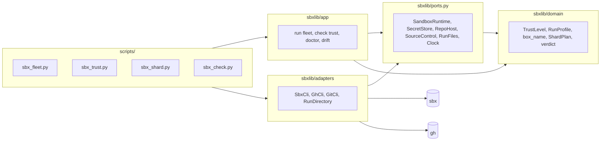

# sandbox-runbook

**An independent community project. It is not made, endorsed or supported by Docker.** "Docker" and "Docker Sandboxes" are Docker,
Inc.'s names, used here only to say what this skill works with.

An agent skill for [Docker Sandboxes](https://docs.docker.com/ai/sandboxes/) (`sbx`). It is a runbook a coding agent follows:
pick a scenario, run its steps, check the result. Scripts do what can be scripted, and every recommendation carries its
evidence state and the sbx version it was seen on.

The `sbx` CLI adapter is the first and only adapter proven here. This is an independent community project, not made or endorsed by Docker.

It exists for two jobs. Moving test time off a laptop, so the interactive loop stays fast. And running code you cannot vouch
for, such as a contributor's pull request, with limits enforced in code rather than in prose, apart from the GitHub setup that
[the CI recipe](skills/sandbox-runbook/docs/use-cases/contributor-prs.md#in-ci) asks for, which no code here can check.

**The testing fleet is measured:** it has run end to end on real boxes, three times per scenario. **The trust layer is beta:** it
held every stranger and fork attack in code and on fakes, and it has never run on GitHub.

**Verified snapshot:** the CLI snapshot is sbx 0.51.0. `sbx_fleet.py` has run end to end against real cloud boxes on 0.51.0, once per
scenario, from a Windows 11 host (gates 4 to 9, 2026-11-05), and then for a first real user on a target project: 13 boxes, 21,859
tests in the main gate, $0.34 by ledger. Gates 4 to 9 ran a second and a third time on 2026-11-06, the third on the round 6 tree,
and a speed run on a target project used 9 boxes, $0.17 by ledger. The code has changed since, and those changes are
tested against a fake built from the real CLI's help, not on a box. Everything else is tested against that fake too. See
[what has been verified](#what-has-and-has-not-been-verified). How the findings came about, wrong turns included, is in
[the history](skills/sandbox-runbook/docs/history.md).

## Quick start

```bash
git clone https://github.com/ffroliva/skills.git
python skills/sandbox-runbook/scripts/sbx_onboard.py <target-project>
# review docs/sbx.md in the target project, then
python skills/sandbox-runbook/scripts/sbx_check.py <target-project>
```

Python 3.12 or later, standard library only. A box's archive is read by the skill's own code, which writes regular files only and
refuses a link, a device, an absolute path or `..`, so it does not rest on `tarfile`'s filter or on a patch release. Tested on
3.12.11, 3.13.3, 3.13.7 and 3.14.7 on Windows, and the archive reader also on 3.13.1 and 3.12.3 on Linux. `sbx_fleet.py` creates
billable boxes. Nothing else here does.

## Install

One copy of the skill, `skills/sandbox-runbook`, with a thin manifest per harness.

| Harness | Install | Update |
|---|---|---|
| Claude Code | `/plugin marketplace add ffroliva/skills`, then `/plugin install ffroliva-skills@ffroliva` | `/plugin marketplace update` |
| Codex | `codex plugin marketplace add ffroliva/skills`, then `codex plugin add ffroliva-skills@ffroliva` | `codex plugin marketplace upgrade` |
| Antigravity | `agy plugin install https://github.com/ffroliva/skills` | the same command |
| Gemini CLI | `gemini extensions install https://github.com/ffroliva/skills` | `gemini extensions update sandbox-runbook` |
| Any other | `npx skills add ffroliva/skills` | `npx skills update` |

Local installs copy ignored folders too; use a Git install for a clean plugin cache.

Nothing above has been run from the pushed repository yet. The manifests pass `claude plugin validate` and `agy plugin validate`;
Codex has no validator, and its manifest copies the shape of plugins installed on one machine. Gemini CLI and `npx skills` come from
other projects' docs, and were not run. The Codex marketplace here is this repository, not a curated list. An Antigravity install
clones the whole repository.

Installed, the scripts live in the harness's own directory, not in your clone: the skill tells the agent to run them from the folder of
the SKILL.md it loaded. On Windows call `python`, never rely on a shebang. Releases are tagged `vX.Y.Z`, with notes in
[CHANGELOG.md](CHANGELOG.md); no tag exists yet.

## Onboarding a target project

`sbx_onboard.py` inspects the project and writes two files into it: `docs/sbx.md`, the adoption file, and
`docs/sbx-recipe.md`, the stack's recipe, filled with the project's name. The adoption file holds which use cases apply and why,
and one `sbx-config` block that every script reads. `target_project` in that block names the project in commands and box names.
For a project that must stay untouched, `--config <path>` writes both elsewhere, and `sbx_check.py` and `sbx_fleet.py` read that file
with their own `--config`. A pull request's trust check still needs the file in a clone of the project.

A rerun refreshes the two generated tables and adds missing settings. Everything a person wrote stays, and a file with no
`sbx-config` block is refused rather than overwritten.

`sbx_check.py` then validates the file and the environment and names each fix. It reads only, and spends nothing.

## Scenarios by trust level

Every scenario is trusted or untrusted, up front. Anything not proven trusted is untrusted, including an error, no network, no
`gh`, an unknown value, or a repository other than the one the adoption file names. Each level has a profile that the fleet
enforces in code, refusing before any box exists, and an untrusted run also refuses an account holding a secret it could reach:
one that is global, or scoped to anything but a single box, with a host it can reach or one it cannot place. [Trust levels](skills/sandbox-runbook/docs/reference/trust.md).

| Level | Scenario | Note |
|---|---|---|
| trusted | Testing fleet, targeted tests: a selected set in one box, for a quick answer | [note](skills/sandbox-runbook/docs/use-cases/targeted-tests.md) |
| trusted | Testing fleet, full suite: every test, split across boxes, one verdict | [note](skills/sandbox-runbook/docs/use-cases/full-suite-offload.md), [sharding](skills/sandbox-runbook/docs/reference/sharding.md) |
| trusted | Feature offload to parallel agents | [note](skills/sandbox-runbook/docs/use-cases/parallel-agents.md) |
| untrusted | Contributor pull requests | [note](skills/sandbox-runbook/docs/use-cases/contributor-prs.md) |
| untrusted | PR review by a sandboxed agent, an untrusted tool or clone | [review](skills/sandbox-runbook/docs/use-cases/pr-review.md), [tool](skills/sandbox-runbook/docs/use-cases/untrusted-code.md) |

The rest are in [SKILL.md](skills/sandbox-runbook/SKILL.md). Deciding who is trusted is your configuration: `own_work`, `trust_roles`,
`trust_team` and `trust_logins` in the adoption file.

## The GitHub token

Whether a pull request is internal or external is resolved through a read-only fine-grained token you create. With no token
every verdict stays untrusted. It lives in `GH_TOKEN` on the host or in CI, and it never enters a box.
[The guide](skills/sandbox-runbook/docs/reference/github-token.md) gives the permissions and a prefilled creation link, and
`sbx_trust.py doctor` names whatever is missing.

## Scripts

| Script | Does |
|---|---|
| `sbx_detect.py` | prints a project's stack as JSON |
| `sbx_onboard.py` | writes or updates the adoption file and recipe |
| `sbx_check.py` | validates that file and the environment, naming each fix |
| `sbx_trust.py` | `check`: the level of one commit of a pull request, as JSON. `doctor`: can the token do that |
| `sbx_shard.py` | `plan`: an assignment from JUnit, as JSON. `check`: the bounds of a plan or a run |
| `sbx_fleet.py` | runs a command per box or across shards on one commit; one verdict. `--sweep-only` cleans up |
| `sbx_drift.py` | compares the installed sbx with the committed CLI snapshot and the newest release |
| `validate_skill.py` | validates this repository |

Fleet exit codes: 0 green, 1 red, 2 not runnable and nothing created, 3 no verdict (a box never ran, and none failed), 130 stopped.
A box or a credential left behind is never exit 0.

The fleet prints each box's name when it is created, with a live read on a trusted run, and ends with its count, a dollar estimate and
the verdict. `--expect-tests` tells a complete run from one that died, red or green. `--means` says what green means on a gate
whose pass and fail are inverted. `--label` names a box in the output. `--max-usd` refuses a run whose worst case costs more. All of
it lands in `verdict.json`.

## Box names

`<target-project>-<mode>-<NN>-<hash>`, for example `acme-shards-01-k3f9`. `NN` is zero-padded to sort, at a width of at least 2.
The four-character hash is random, and shared by every box of a run. Before any create, the fleet refuses a live box or a
leftover scoped secret with that name, even though a repeat is unlikely. The reason is a real one: on sbx 0.50.1 and 0.51.0 a
scoped secret outlives its box, and the next box with that name receives it. Results land in a folder of the box's name.

sbx states the characters a name may hold, not a maximum length, so the 30-character limit on the project part is a cautious guess.

## Checking for sbx drift

`sbx_drift.py check` compares the `--cloud` commands and flags this skill calls with
[`cli-snapshot.json`](skills/sandbox-runbook/references/cli-snapshot.json), and with the newest release. Exit 0 aligned, 4 drift, 3 could not check,
which is never read as aligned. A weekly workflow opens one issue when the snapshot falls behind. The steps are in
[SKILL.md](skills/sandbox-runbook/SKILL.md#when-this-skill-goes-stale).

The skill's command-selection evals are in `evals/`. Run them manually by giving each prompt to the agent, recording its
CLI commands as a UTF-8 JSON array, then running `python skills/sandbox-runbook/scripts/eval_scenarios.py <scenario-id> <transcript.json>`.
This scores command order and forbidden commands only; it does not call a model. Live runs are manual and use a dedicated
`--app-name` when probing sbx so they do not touch the owner's daemon (on sbx 0.51.0, verified 2026-11-06, the isolated daemon is not signed in, so it answers `settings` and `version` only and cannot create boxes or list).

## Troubleshooting

[Troubleshooting](skills/sandbox-runbook/docs/troubleshooting.md) has one entry per failure: symptom, exact error text, cause, fix, how to confirm,
and the version it was seen on. Search it by the error string. `sbx_check.py` and `sbx_fleet.py` print the entry's anchor when they
recognise an error.

## Architecture

Ports and adapters. The domain is pure: trust levels, run profiles, box names, the box script, verdicts and shard plans. Ports are
`typing.Protocol`s. Adapters wrap the `sbx` CLI, `gh`, git, processes and files. The scripts are thin entry points, so an installed
plugin runs them by path with no install step.



Dependencies point inward, and `tests/test_architecture.py` enforces it with planted violations. The test fake replaces the process,
never the adapter: it refuses any flag absent from the CLI snapshot and keeps a scoped secret after `rm`, as the real tool does.
`tests/test_contract.py` runs one suite against the fake, and against the real tool with `SBX_LIVE=1`, which costs money and which CI never
sets. Details: [architecture](skills/sandbox-runbook/docs/reference/architecture.md).

## Evidence, and how to read its labels

| Label | Means |
|---|---|
| `measured` | a script, and repeated runs |
| `tried-once` | one run |
| `untested-idea` | no evidence; not a recommendation |
| measured on a target project, not independently reproducible | a run on a project this skill was applied to; shape and repeat count given, source unpublished |

Public evidence links are pinned to a commit. Most findings were measured on a Windows 11 host; macOS and Linux hosts are not
tested. [Evidence and versions](skills/sandbox-runbook/docs/reference/evidence.md).

## Measurements still owed

[The list](skills/sandbox-runbook/docs/reference/evidence.md#measurements-still-owed) is the source. Its head: the fleet on real boxes since the
last code change, why 40 tests fail in a box and pass on CI, a physical Ctrl+C, the account's own quota refusal, the live contract
test, more than 10 boxes (40 vCPU allows 5 of 8 or 20 of 2, sbx 0.50.0), a real fork's test suite in a box, the CI templates on GitHub, a fine-grained token
against `doctor`, and a real install on each harness. No billing figure was read for any run: the dollars are a ledger.

## Credits

The routing and eval ideas were informed by [docker/skills](https://github.com/docker/skills) (Apache-2.0),
[shelajev/sbx-skill](https://github.com/shelajev/sbx-skill) (Apache-2.0), and
[docker/sbx-kits-contrib](https://github.com/docker/sbx-kits-contrib) (Apache-2.0). The spike-and-stub and idle-stop ideas
were informed by [mattjohnson/orca-sbx-recipes](https://github.com/mattjohnson/orca-sbx-recipes) (MIT), and
[karanverma/sbx-ai-eval-kit](https://github.com/karanverma/sbx-ai-eval-kit) (MIT) informed evidence-recording ideas.
Ideas and facts only; no text was copied.

## What has and has not been verified

Rows marked 2026-11-06, "second" or "third" ran on the uncommitted tree of that day; "third" is the round 6 tree. Nothing changed in round 7 has run on a box: the archive writer, the scope rule for secrets, the cap on JUnit cases, the ran, skipped and lost counts, the `##[` guard, and the template's skill-commit check. Any other "tried once" ran on the code as it stood then, and "field run" means the first real use, on a frozen snapshot: [the table](skills/sandbox-runbook/docs/reference/evidence.md#the-first-real-use-on-0510). The rows at the end say what that leaves open.

| Fact | sbx | State |
|---|---|---|
| `shell` creates, runs Docker, `hello-world` pulls | 0.51.0 | smoke run, 2 boxes, on a target project |
| `shell-docker` refused as agent, template and kit | 0.51.0 | same run |
| `-e NAME=value` reaches `exec` under `--cloud` | 0.51.0 | same run; the bare form is in the row below |
| `secret set-custom` with `--cloud`, before create | 0.51.0 | same run |
| A scoped secret outlives `rm` | 0.50.1, 0.51.0 | measured |
| CLI flags the scripts pass | 0.51.0 | checked against `--cloud --help`, by the test fake |
| `sbx_fleet.py` targeted, 1 box of 4 vCPU, a public Python project | 0.51.0 | **tried three times**, the third on the round 6 tree: 451 ran plus 4 skipped, rc 0, 70 s, `complete: true` with `--expect-tests 451`. The same run with `--expect-tests 455` was red and said "tests were lost" where the 4 were skips; round 7 reports ran, skipped and lost apart, on the fake only |
| Sharded, 3 boxes | 0.51.0 | **tried three times**, the third on the round 6 tree: 2,490 ran plus 8 skipped (465 + 551 + 1,482 reported), `complete: true`, green |
| A shard lost mid-run | 0.51.0 | **tried three times**: box deleted by hand, fleet red, `INCOMPLETE: box 2 did not finish, 1940 of 2490 expected tests, 7 skipped`, `complete: false`; `sbx_shard.py check` says a shard was lost |
| CTRL_BREAK to the fleet | 0.51.0 | **tried three times**, the last two with 2 boxes and a scoped secret each: exit 130, boxes and secrets removed, account empty |
| A physical Ctrl+C | none | **not run**: the test harness had no console to send it from |
| Hard kill | 0.51.0 | **tried three times**: box and scoped secret stay; the box died at its TTL (gone 270 s after the fleet started, the third time); `--sweep-only` removed the secret |
| Name collision (live box, leftover secret) | 0.51.0 | **tried three times**: both refused before create |
| A request over the declared quota or an off-shape request | 0.51.0 | **tried three times**: refused before create, and `sbx` itself refuses the off-shape request. The account's own quota refusal was not triggered |
| Trust check with a real `gh` OAuth token | n/a | **tried once** on a member pull request, a fork author, a changed sha, no token, a bad token, a repository with no access. Repeated twice on 2026-11-06, with an open pull request of a public project, a real fork's, `adoption-file-changed` and `repo-mismatch` |
| Trust check with a fine-grained token | n/a | **not run**: permissions come from GitHub's docs |
| Account network default | 0.51.0 | read with `policy ls --json`; the fleet now refuses an untrusted run unless it reads `deny-all`. Enforcement seen once in a live box |
| Custom secret through the fleet | 0.51.0 | **tried three times** (`--secret-service custom:<host>:<ENV>`), the third on the round 6 tree: placeholder in the box, `Authorization: Bearer <fake value>` at the allowed host, deleted after |
| Bare `-e NAME` under `--cloud` | 0.51.0 | **tried three times**: the variable reached the box |
| Testcontainers in a box | 0.50.1, 0.51.0 | measured on 0.50.1; **tried three times** on 0.51.0 with a PostgreSQL 17 container (the third on the round 6 tree, 1 of 1 expected, 28 s); a field run on a target project started a container per row, a project defect |
| Heavy gates, one command per box | 0.51.0 | **tried once**, field run on a target project: 21,859 tests, 8 min 52 s, 6 boxes of 8 vCPU, about $0.20 by ledger |
| Test optimisation, an A/B in boxes | 0.51.0 | **measured once**, on a target project, 2026-11-06: one file 34.4 s to 22.2 s, median of 12 runs a side on 3 boxes of 4 vCPU, spread 34.1-35.4 against 22.0-22.5, about $0.17 for three fleets. CI's confirmation **not measured**: box seconds ran 1.4 to 1.6 times CI's |
| One command repeated per box | 0.51.0 | **tried once**, on the round 6 tree: one command on 2 boxes counted 4 ran, 2 skipped, green at `--expect-tests 4`; a command reading `$SHARD` on 2 boxes counted its repeated cases once, 2 of 2. At `--expect-tests 6` the run was red and called the 2 skips lost, the wording round 7 fixes |
| `author_association` reading `CONTRIBUTOR` for a private member | n/a | **unverified** |
| Box script | 0.51.0 | runs in real bash against a local git remote, and in real boxes through the runs above. `--repo` is now quoted, in real bash only |
| Ctrl+C and SIGTERM | none | tested with a raised signal on a fake |
| Adoption-file guard, repository binding, global-secret refusal | n/a | **tried twice on the real account, 2026-11-06**, the second on the round 6 tree, where `sbx_check.py` named the global secret too. The first: H1 refused on a real pull request's changed path; H2 refused with a fake global `github` secret set and removed at once (the global row `scope: global` was seen); H3 refused for a secret, and an own-work run in a foreign repository ran untrusted |
| JUnit outcomes in the verdict, the streaming archive reader | 0.51.0 | **field run**, 13 boxes, on a snapshot whose reader differs from the final tree in its exception list and types |
| Exit 3 for a partial refusal | none | **fake only**: the retry of `settings platform construction failed` is read in `_create` and pinned by a test with the exact text; it cannot be forced on a real account |
| Refusal of a trusted file with no `repo`, box lines at create, `--expect-tests`, `--means`, `--label`, `--max-usd`, `--config` on `sbx_check.py` and `sbx_onboard.py` | none | **tried once on real boxes, 2026-11-06**: the trusted-without-`repo` refusal, box lines with the exec read on a trusted run, `--expect-tests`, `--means`, `--label`, `--max-usd` (refusal and `estimated_usd` in `verdict.json`). `--config` on `sbx_check.py` and `sbx_onboard.py` stay fake and real bash only |
| A test passing on CI and failing in a box | 0.51.0 | **seen once**, 40 tests; a second case found 2026-11-06 in one of a target project's test files, caused by `git worktree repair` on the box's git 2.47.3 (CI had 2.56.0); the 40 are still unexplained: [entry](skills/sandbox-runbook/docs/troubleshooting.md#red-in-box-green-on-ci) |
| The hosts each service's secret reaches | n/a | **Docker's page, read 2026-11-05**: not measured |
| A real fork's pull request in a box | 0.51.0 | **tried once, 2026-11-06**: through `--pr`, level untrusted, rc 0, `--no-junit`, a one-line command, no log back. A real fork's test suite has not run |
| The CI templates for fork pull requests | none | **not run on GitHub**: tested as text and in real bash, clean under zizmor and actionlint |
| `sbx login --password-stdin` in a job | none | **not run**: Docker documents it for CI and cloud sandboxes, and `sbx login --help` on 0.51.0 shows it |
| A killed `create` | 0.51.0 | **tried once**, on the round 6 tree: the create's own `sbx` process killed; `possibly left behind` named the box, exit 3, and the account was empty at the fleet's exit |
| A non-empty account allow list | none | **fake only**: the list is the documented shape |
| An archive with a link, on a Python whose `tarfile` filter is bypassed | none | **probe only**: the review's archive overwrote a host file on Python 3.13.1 on Linux before round 7, and is refused after it. No box has sent one |
| `tests/test_contract.py` with `SBX_LIVE=1` | none | **not run** |
| CI, CodeQL, the drift and mutant jobs | n/a | **not run**: linted with actionlint and zizmor only; nothing is pushed |
| macOS and Linux hosts | any | not tested |
| An install from GitHub, on any harness | n/a | not run. `claude plugin validate .` and `agy plugin validate .` pass; `agy` finds 1 skill |

## Contribute

1. Measure in a public repo, with a script, a log and a repeat count. Measure twice.
2. Add one line to a note under `skills/sandbox-runbook/docs/`, with a link pinned to a commit and the sbx version.
3. Write the test first, and see it fail on an assertion.

```bash
python -m unittest discover -s tests
ruff check
pyright
python skills/sandbox-runbook/scripts/validate_skill.py
python scripts/check_versions.py  # every manifest, one version; CI also holds a tag to it
claude plugin validate .
agy plugin validate .
python tests/mutants.py  # minutes: every safety mutant must die; weekly in CI
```

Report a vulnerability privately: see [SECURITY.md](SECURITY.md). Never add a project's details, a person's name, a local path or a secret. `validate_skill.py` runs generic leak checks, and reads an
optional word list from `SBX_SKILL_DENYLIST`, which must point outside the repository. No such list is ever committed.

## Licence

Apache-2.0. See [LICENSE](LICENSE).
